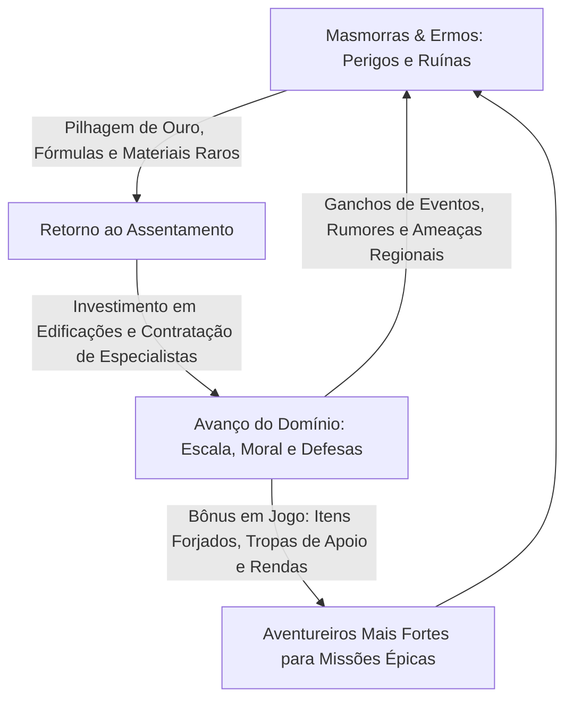

# 🏰 MANUAL DO SOBERANO: BASTIÕES, ASSENTAMENTOS & REINOS
## Sistema Completo e Independente de Gestão de Domínios para RPG de Mesa
### Compatível com D&D 5.5, *Forbidden Lands*, *MCDM* e motores d20 ágeis

---

# 📖 CAPÍTULO ZERO: PARA QUEM NUNCA JOGOU RPG

Se este é o seu primeiro contato com um RPG de mesa (*Role-Playing Game*), seja muito bem-vindo! Você não precisa de nenhum livro prévio para entender este manual.

### O que é um RPG de Mesa?
Pense no RPG como uma série de TV ou jogo de videogame coletivo, mas que acontece na imaginação e na conversa ao redor de uma mesa (ou chamada de voz).
* **Os Jogadores:** Cada pessoa controla um herói (um guerreiro destemido, uma feiticeira astuta, um ladino furtivo ou um sacerdote devoto).
* **O Mestre (Narrador):** Uma pessoa assume o papel de Mestre. Ele descreve o mundo, os perigos, os monstros e os aldeões, além de arbitrar as regras de forma justa.

---

### O que é o "Assentamento" ou "Bastião"?
Na maioria dos RPGs tradicionais, os heróis são nômades que dormem ao redor de fogueiras ou em quartos de taverna. Neste sistema, **o grupo tem um lar**. 
Pode ser um acampamento no meio de uma floresta misteriosa, uma velha torre de vigia abandonada que vocês limparam de monstros, ou uma aldeia inteira que jurou lealdade a vocês.

O Assentamento funciona como uma **Ficha de Personagem Coletiva da Equipe**:
1. Vocês decidem em grupo o que construir (muralhas, forjas, fazendas, bibliotecas).
2. O que vocês conquistam nas masmorras (ouro, ferro, madeira, fórmulas arcanas) é investido na base.
3. A base retribui fornecendo armas melhores, poções de cura gratuitas, tropas de proteção e abrigo seguro.

---

### O Vocabulário Básico em 1 Minuto

| Termo | O que significa na prática? |
| :--- | :--- |
| **d20** | O dado de vinte lados. É o coração do jogo. Sempre que você tenta algo difícil ou perigoso, rola o d20. |
| **Modificador (+X / -X)** | Um bônus que você soma ao resultado do dado para representar treinamento, força física ou inteligência. |
| **CD (Classe de Dificuldade)** | O número-alvo que você precisa igualar ou superar no d20 para ter sucesso (Fácil = 10, Médio = 13, Difícil = 16, Épico = 20). |
| **Downtime (Tempo de Paz)** | As semanas ou meses que passam no mundo do jogo entre uma aventura e outra, onde os heróis descansam e administram suas terras. |
| **Escala (Tier)** | O nível de desenvolvimento do seu domínio: vai de I (Acampamento) até IV (Grande Cidade/Reino). |

---

# 🎭 CAPÍTULO UM: UM TURNO REAL NA MESA (EXEMPLO NARRADO)

Para entender como tudo flui com leveza sem parecer uma reunião chata de contas, veja como um turno de 10 minutos acontece na mesa entre o Mestre (Pedro) e os jogadores (Ana, Bruno e Carla):

> **Mestre (Pedro):** *"Muito bem, pessoal! Vocês derrotaram a hidra nos pântanos e voltaram para o Forte da Vigia com duas carroças cheias de couro escamoso e 300 moedas de ouro. O inverno está chegando. Vamos rodar o Turno da Estação do assentamento!"*
> 
> **Ana (jogando com a Paladina):** *"Ótimo! O que nossas fazendas produziram?"*
> 
> **Mestre (Pedro):** *"Vocês têm duas fazendas ativas. Passo 1: Produção. Vocês ganham +6 Unidades de Víveres (comida). Mas no Passo 2: Manutenção, a população de 200 aldeões consome 2 Víveres e 2 Ouros. O saldo de comida de vocês continua positivo e farto! Todos comeram bem. A Moral continua alta em 80 pontos."*
> 
> **Bruno (jogando com o Mago):** *"Agora é o Passo 3: Ordens do Grupo! Nós temos direito a duas ordens cada um. Eu quero usar a madeira que trouxemos e mandar os pedreiros começarem as obras do nosso Laboratório Alquímico!"*
> 
> **Mestre (Pedro):** *"Excelente. O laboratório custa 3 Madeiras, 2 Pedras e 3 Ouros. Como você é um mago supervisionando a obra, faça um teste de Inteligência do Domínio contra CD 13 para ver se os artesãos evitam desperdício."*
> 
> **Bruno:** *(Rola o d20 e tira 15 + 2 = 17)* *"Tirei 17! Sucesso!"*
> 
> **Mestre (Pedro):** *"Perfeito! As bancadas de destilação foram montadas sem atrasos. No final deste mês o laboratório estará pronto para produzir poções de cura grátis para vocês! Ana, o que você faz?"*
> 
> **Ana:** *"Eu vou para o pátio de armas treinar a milícia camponesa na lança e escudo. Quero nossos guardas afiados!"*
> 
> **Mestre (Pedro):** *"Anotado! Se o forte for atacado, suas tropas ganham +1 de bônus em combate. Agora, o Passo 4: O Evento Regional! Eu vou rolar 1d20 na tabela de eventos..."* *(Pedro rola atrás do escudo e tira um 2).*
> 
> **Mestre (Pedro):** *"Atenção: batedores entram galopando pelos portões da vila com flechas cravadas na sela! Uma tribo de orcs nômades desceu das montanhas geladas buscando abrigo do inverno e montou acampamento a três léguas daqui. Eles estão saqueando as fazendas vizinhas. O que vocês fazem?"*
> 
> **Carla (jogando com a Ladina):** *"Pegamos nossas armas. Vamos investigar o acampamento deles antes que cheguem nas nossas muralhas!"*
> 
> **Mestre (Pedro):** *"E assim começa a aventura de hoje! Peguem suas fichas de personagens!"*

Percebeu? Em menos de 10 minutos, o grupo arrecadou recursos, construiu melhorias, preparou as defesas e **o próprio sistema gerou a próxima aventura da noite** de forma natural e emocionante!

---

# 🧭 CAPÍTULO DOIS: O LOOP DE AVENTURA

Muitos sistemas de castelos falham por virarem uma planilha burocrática ou um catálogo de salas isoladas onde nada de perigoso acontece. O motor deste manual é desenhado no **Loop de Aventura**:



---

# PARTE I — AS 4 ESCALAS DO ASSENTAMENTO (TIERS)

Todo domínio começa pequeno. À medida que o grupo acumula riquezas, derrota monstros territoriais e atrai colonos, o assentamento sobe de **Escala (Tier)**.

| Escala | Denominação | População | Nível dos Heróis | Instalações Máximas | Bônus de Proficiência |
| :---: | :--- | :---: | :---: | :---: | :---: |
| **I** | **Acampamento / Posto Avançado** | 10 – 100 hab. | 1º – 4º | 3 Instalações | **+2** |
| **II** | **Aldeia / Forte de Fronteira** | 100 – 1.000 hab. | 5º – 8º | 6 Instalações | **+3** |
| **III** | **Vila Amuralhada / Cidadela** | 1.000 – 10.000 hab. | 9º – 12º | 10 Instalações | **+4** |
| **IV** | **Grande Cidade / Capital de Reino** | 10.000+ hab. | 13º+ | 15+ Instalações | **+5 a +6** |

### Condições para Subir de Escala:
1. **Edificação Âncora Construída:** (Paliçada para Escala I; Muralhas de pedra e torre para Escala II; Castelo e catedral/mercado mestre para Escala III).
2. **População e Moral Estáveis:** Sem crise de fome ou revolta ativa.
3. **Missão de Fronteira Concluída:** O grupo precisa derrotar a ameaça regional dominante (um bando de gigantes, um dragão jovem ou um lorde rival).

---

# PARTE II — A FICHA COLETIVA DO DOMÍNIO

### 1. Os Seis Atributos Cívicos
Os atributos usam a mesma escala clássica (-1 a +5 de modificador):

* **FORÇA (Trabalho & Guerra):** Obras públicas, mineração, corte de madeira, defesa de muralhas e disciplina militar.
* **DESTREZA (Logística & Subterfúgio):** Rotas de suprimento, estradas seguras, patrulhas leves, batedores e caça a contrabandistas.
* **CONSTITUIÇÃO (Saúde Pública & Solidez):** Resistência das muralhas, celeiros contra geadas, esgotos e resistência a pragas e cercos.
* **INTELIGÊNCIA (Tecnologia & Saber):** Laboratórios, engenharia militar, cartografia, arquivos históricos e escolas arcanas.
* **SABEDORIA (Espiritualidade & Produção Rural):** Conexão com divindades da terra, colheitas, moral do clero e harmonia com as leis tradicionais.
* **CARISMA (Prestígio & Comércio):** Atração de mercadores distantes, diplomacia com reinos vizinhos, feiras e reputação cultural.

> **Como Calcular os Atributos Iniciais:**
> Todo atributo começa em **10 (+0)**.
> Some **+2** no atributo para cada herói do grupo que seja treinado em áreas afins (ex: Guerreiros/Paladinos somam em Força; Ladinos/Patrulheiros em Destreza; Magos em Inteligência; Clérigos/Druidas em Sabedoria; Bardos/Bruxos em Carisma).
> *(Limite máximo natural: 20 (+5). Instalações lendárias podem elevar além).*

---

### 2. A Vitalidade do Domínio: População & Moral

O domínio tem duas barras vitais:
* **POPULAÇÃO:** O contingente humano útil. Se chegar a ZERO por pragas ou massacres, o local vira uma ruína fantasma abandonada.
* **MORAL (0 a 100 pontos):** A esperança e coesão da sua gente:
  * **76–100 (Eufórico):** Todos os testes do domínio ganham **+1d4 de bônus**.
  * **26–75 (Estável):** Vida normal e pacífica.
  * **11–25 (Turbulento):** Desvantagem em testes diplomáticos; boatos de motim.
  * **0–10 (Revolta Aberta):** Greve geral, comércio fechado e risco de tochas acesas contra o castelo.

### 3. Reserva de Emergência (O "Escudo Governamental")
Representa baús de moedas enterrados e depósitos secretos de grãos.
* Quando o assentamento falha em um teste e vai perder População ou Moral, o gestor pode queimar **1 Ponto de Reserva** para reduzir o prejuízo:
  $$\text{Dano Mitigado} = 5 \times \text{Círculo da Reserva (1º ao 5º)}$$

---

### 4. Estoque de Recursos Tangíveis (Inspirado em *Forbidden Lands*)
Em vez de contar moedas de cobre uma a uma, usamos unidades padronizadas de carga:

* 🪙 **Ouro / Riqueza:** Tesouro líquido para pagar mercenários e comprar materiais exóticos.
* 🪵 **Madeira Bruta:** Extraída de matas ([loots/expandido/04_floresta_pantano.md](file:///c:/Users/Drysrina/Desktop/RPG/QUICKSHOW/loots/expandido/04_floresta_pantano.md)) para vigas, paliçadas e andaimes.
* 🪨 **Pedra / Alvenaria:** Extraída de pedreiras ([loots/expandido/05_montanha_masmorra.md](file:///c:/Users/Drysrina/Desktop/RPG/QUICKSHOW/loots/expandido/05_montanha_masmorra.md)) para muralhas e fundações.
* ⚒️ **Minério / Metal:** Ferro para armaduras, arados, pregos e ferramentas.
* 🌾 **Víveres (Comida):** Sacas de grãos, carne seca e peixe para alimentar o povo.
* 🔮 **Materiais Místicos:** Fragmentos raros de monstros e covis ([loots/expandido/08_covil_curiosidades.md](file:///c:/Users/Drysrina/Desktop/RPG/QUICKSHOW/loots/expandido/08_covil_curiosidades.md)) para forjar itens mágicos e círculos arcanos.

---

# PARTE III — O TURNO DE DOWNTIME ÁGIL

O Turno de Domínio acontece a cada **Estação do Ano** (Primavera, Verão, Outono, Inverno) ou **Mês de Campanha**, levando apenas **10 a 15 minutos**:

```
    [1. PRODUÇÃO] ──> Recolha Ouro, Comida e Materiais das Instalações.
           │
    [2. CONSUMO]  ──> Pague 1 Comida e 1 Ouro por 100 hab. (Falta de comida = Fome e -Moral).
           │
    [3. ORDENS]   ──> Cada herói escolhe 2 ações (Construir, Treinar, Forjar, Explorar).
           │
    [4. EVENTO]   ──> O Mestre rola 1d20 na Tabela Regional para surpresas e ganchos.
```

### Tabela de Eventos Regionais (1d20)

| d20 | Evento | Consequência Mecânica & Gancho Narrativo |
| :---: | :--- | :--- |
| **1** | **Praga ou Epidemia** | Teste de Constituição (CD 14). Falha: -15 Moral e 10% da população adoece. |
| **2** | **Bando Invasor Avistado** | Invasores ameaçam os limites. O grupo lidera a defesa ou perde 2 Recursos. |
| **3** | **Seca / Geada Severa** | Produção de comida cai pela metade nesta estação. |
| **4** | **Atrito entre Facções** | Guilda mercantil e artesãos entram em greve por impostos. Requer mediação. |
| **5** | **Cobrador do Suserano** | Exige 10% do ouro acumulado em impostos para a coroa. |
| **6** | **Incêndio Acidental** | Teste de Destreza (CD 13) dos vigias. Falha: 1 oficina fica danificada. |
| **7** | **Refugiados Famintos** | $+200$ colonos chegam fugindo de uma guerra vizinha. Acolher ou barrar? |
| **8** | **Nevasca / Chuva Torrencial** | Estradas cortadas por 1 mês; teste de Con (CD 12) para evitar avarias em telhados. |
| **9** | **Espião Capturado** | Infiltrador é pego com plantas das defesas do forte. Quem o contratou? |
| **10** | **Paz e Rotina Serena** | Nenhuma crise relevante. O povo descansa feliz (+5 Moral). |
| **11** | **Caravana de Mercadores** | Especiarias e quinquilharias exóticas (+2 Ouro e itens mágicos à venda). |
| **12** | **Trupe Teatral / Menestréis** | Espetáculos animados erguem o ânimo de todos (+10 Moral). |
| **13** | **Veio Mineral Descoberto** | Mineiros acham uma fenda com veios de prata ou ferro (+3 Minério). |
| **14** | **Recrutas Voluntários** | Histórias dos feitos dos heróis atraem soldados voluntários (+1 Unidade Militar). |
| **15** | **Colheita Abençoada** | A terra produz acima da média (+4 Víveres extras e celebração rural). |
| **16** | **Oferta de Aliança Política** | Lorde de uma cidade vizinha envia embaixada propondo livre comércio. |
| **17** | **Mestre Artesão Solícita** | Um ferreiro lendário quer abrir oficina no seu feudo (+1 bônus em forja). |
| **18** | **Peregrinação Sagrada** | Devotos visitam os santuários locais doando ouro e relíquias (+3 Ouro). |
| **19** | **Contrato de Guilda Cumprido** | Comboio de carretas traz materiais encomendados (+3 Madeira, +2 Metal). |
| **20** | **Época de Ouro!** | Renome internacional! O domínio ganha **+1 Ponto de Reserva** e **+20 Moral**! |

---

# PARTE IV — CATÁLOGO DE EDIFICAÇÕES & INSTALAÇÕES

## 1. Produção e Sustento
* **Fazendas & Celeiros (Escala I):** Custo: 2 Madeira, 1 Ouro. Rende $+3$ Víveres por estação e suporta $+150$ pessoas.
* **Serraria Hidráulica (Escala I):** Custo: 3 Madeira, 1 Metal, 1 Ouro. Rende $+2$ Madeiras por estação e barateia obras futuras.
* **Pedreira de Cantaria (Escala I):** Custo: 2 Madeira, 2 Metal, 2 Ouro. Rende $+2$ Pedras por estação.
* **Mina de Ferro Profunda (Escala II):** Custo: 4 Madeira, 3 Pedra, 3 Ouro. Rende $+2$ Minérios e $+1$ Ouro por estação.

## 2. Fortificações e Tropa
* **Paliçada de Madeira (Escala I):** Custo: 5 Madeira, 2 Ouro. Fornece **+2 de Defesa** contra invasores.
* **Muralha de Pedra Entalhada (Escala II):** Custo: 8 Pedra, 3 Metal, 5 Ouro. Fornece **+5 de Defesa** e bloqueia projéteis leves.
* **Quartel e Campo de Tiro (Escala I):** Custo: 3 Madeira, 2 Pedra, 2 Ouro. Mantém até 2 Unidades Militares. Treinar aqui concede **+1 Dado de Inspiração Marcial (1d6)** aos heróis.
* **Torre de Vigia com Sinalizador (Escala I):** Custo: 3 Madeira, 2 Pedra, 1 Ouro. Impede ataques surpresa contra o feudo.

## 3. Conhecimento, Arcano e Fé
* **Grande Forja e Armaria (Escala II):** Custo: 4 Pedra, 3 Metal, 3 Ouro. Permite comprar armaduras com 40% de desconto e forjar armas de prata ou metal estelar.
* **Laboratório Alquímico (Escala II):** Custo: 3 Madeira, 2 Pedra, 1 Místico, 3 Ouro. Produz **2 Poções de Cura** gratuitas para o grupo por estação.
* **Biblioteca e Arquivo Histórico (Escala II):** Custo: 4 Madeira, 2 Pedra, 3 Ouro. Concede Vantagem em pesquisas de monstros e identificação de mapas antigos.
* **Templo ou Santuário Consagrado (Escala II):** Custo: 5 Pedra, 2 Madeira, 1 Místico, 4 Ouro. Abençoa heróis divinos com 1 uso gratuito de *Auxílio* ou *Restauração*.

## 4. Vida Comunitária e Crime
* **Taverna & Estalagem da Encruzilhada (Escala I):** Custo: 4 Madeira, 1 Pedra, 2 Ouro. Rende $+10$ Moral permanente e atrai boatos e mercenários ([loots/Serviços de Taverna e Padaria.md](file:///c:/Users/Drysrina/Desktop/RPG/QUICKSHOW/loots/Serviços%20de%20Taverna%20e%20Padaria.md)).
* **Covil das Sombras / Rede de Espionagem (Escala II):** Custo: 2 Pedra, 3 Madeira, 3 Ouro. Avisa os heróis sobre conspirações rivais e tentativas de assassinato antes que ocorram.

---

# PARTE V — SISTEMA DE CERCO E BATALHA EM MASSA

Se uma horda de orcs ou exército rival marchar contra seus portões, você **não precisa de dezenas de miniaturas**. Resolva a batalha em **3 Fases Épicas**:

```
┌────────────────────────────────────────────────────────────────────────┐
│ FASE 1: SALVA DE CERCO & APROXIMAÇÃO                                   │
│ Catapultas e flechas chovem. Teste de Destreza/Guerra do Domínio vs    │
│ Ataque Inimigo. Magias de área dos heróis (ex: Bola de Fogo) reduzem   │
│ imediatamente a força do invasor!                                      │
├────────────────────────────────────────────────────────────────────────┤
│ FASE 2: IMPACTO NAS MURALHAS & DEFESAS                                 │
│ A Fortificação (Paliçada ou Muralha) absorve o dano como Escudo.       │
│ Se a muralha romper: A luta vai para as ruas e casas dos aldeões!      │
├────────────────────────────────────────────────────────────────────────┤
│ FASE 3: CONFRONTO DOS CAMPEÕES (O DUELO DECISIVO)                     │
│ Os heróis enfrentam o General Invasor ou Monstro Alfa em combate       │
│ pessoal. Derrubar o líder força o exército invasor a fugir em pânico!  │
└────────────────────────────────────────────────────────────────────────┘
```

* **Vitória:** O inimigo debandou. O grupo rola recompensas na tabela [loots/expandido/01_pos_combate.md](file:///c:/Users/Drysrina/Desktop/RPG/QUICKSHOW/loots/expandido/01_pos_combate.md). O domínio ganha $+15$ Moral.
* **Derrota:** Os portões cedem e a vila é pilhada. O grupo deve evacuar os civis para as colinas e planejar uma revanche.

---

# 👑 PARTE VI — O GUIA DO MESTRE: COMO CONDUZIR E NARRAR

Conduzir um jogo com assentamento é uma das experiências mais gratificantes do RPG, pois transforma jogadores desinteressados em **donos do mundo**. Aqui estão os segredos para narrar com maestria:

### 1. Os 3 Ganchos de Fundação (O "Dia 1")
Como entregar a base para os jogadores pela primeira vez?
* **A Ruína Conquistada (Nível 1–3):** A primeira missão do grupo é limpar um covil de goblins ou bandidos numa colina com uma torre de menagem em ruínas. Quando vencem, o líder dos bandidos está morto e o lugar está vazio. O mestre diz: *"Vocês olham para estas velhas muralhas de pedra sólida e percebem: com um pouco de trabalho, este lugar pode ser de vocês."*
* **A Concessão Nobre (Nível 4–6):** Em recompensa por salvar uma cidade, o Barão local não tem ouro suficiente para pagar os heróis, mas assina um documento concedendo uma província remota e perigosa na fronteira: *"Pela lei da coroa, a terra é de vocês... se conseguirem defendê-la."*
* **Os Pioneiros Refugiados (Qualquer Nível):** Aldeões que tiveram sua aldeia natal destruída por um dragão seguem os heróis suplicando por liderança: *"Vocês são fortes. Construam um santuário para nós e nós lavraremos seus campos e forjaremos suas espadas."*

---

### 2. A Regra de Ouro do Ritmo (80 / 20)
* **20% do Tempo (10 a 15 min):** Gerencie o turno no começo ou no final da sessão. Deixe os jogadores decidirem as obras com entusiasmo.
* **80% do Tempo:** Jogue a aventura tradicional! As construções devem gerar ganchos para as missões (ex: *"Para terminar a forja, precisamos de ferro anão que só existe nas minas abandonadas da montanha"*).

---

### 3. Como Ameaçar o Assentamento sem Frustrar os Jogadores
* **Regra Fundamental: Telegrafe o Perigo!** Nunca diga: *"Vocês acordam e o celeiro foi queimado, percam 5 comida."* Isso soa injusto e punitivo.
* **Faça Assim:** Diga: *"Os batedores da torre avistaram fumaça na colina leste. Pegadas de trogloditas foram achadas perto dos silos de trigo. Vocês têm 2 dias antes que tentem invadir. O que vocês fazem?"* Dê aos jogadores a oportunidade de defender o que construíram!

---

# 📦 PARTE VII — GUIA DE CONVERSÃO DE SAQUES

Converta o saque dos monstros das tabelas de [`loots/`](file:///c:/Users/Drysrina/Desktop/RPG/QUICKSHOW/loots) diretamente em suprimentos para a base:

| Saque de Aventura Encontrado | Conversão para o Domínio |
| :--- | :--- |
| **100 Moedas de Ouro (PO) em baús** | **1 Unidade de Ouro/Riqueza de Domínio**. |
| **Troncos gigantes, carretas de madeira, couros de feras** | **1 a 3 Unidades de Madeira**. |
| **Blocos de rocha entalhada, minério bruto de masmorras** | **2 Unidades de Pedra ou Metal**. |
| **Fórmulas alquímicas, pergaminhos arcanos, sangue dracônico** | **1 Unidade de Material Místico**. |
| **Prisioneiros resgatados de masmorras** | **+20 a +50 de População grata** pronta para trabalhar. |

---

*Manual do Soberano — Transforme aventureiros errantes em senhores de lendas.*
