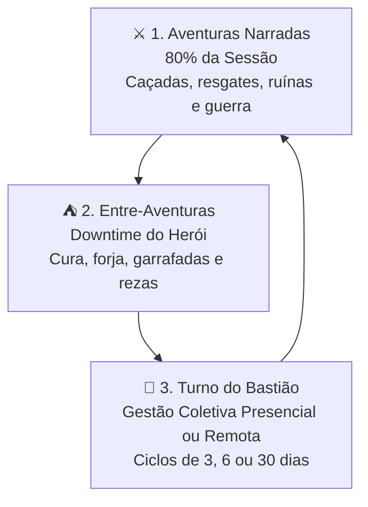

# 🏹 OS TERRATENENTES — ALDEIAS, QUILOMBOS & FORTES
### Sistema Standalone de RPG de Fronteira, Sobrevivência e Gestão de Assentamentos

[](LICENSE)
[](#)
[](#)
[](#)

---

```
  ██████╗ ███████╗    ████████╗███████╗██████╗ ██████╗  █████╗ 
 ██╔═══██╗██╔════╝    ╚══██╔══╝██╔════╝██╔══██╗██╔══██╗██╔══██╗
 ██║   ██║███████╗       ██║   █████╗  ██████╔╝██████╔╝███████║
 ██║   ██║╚════██║       ██║   ██╔══╝  ██╔══██╗██╔══██╗██╔══██║
 ╚██████╔╝███████║       ██║   ███████╗██║  ██║██║  ██║██║  ██║
  ╚═════╝ ╚══════╝       ╚═╝   ╚══════╝╚═╝  ╚═╝╚═╝  ╚═╝╚═╝  ╚═╝
              T E N E N T E S   D A   T E R R A
```

> *"Quem não finca raiz na terra que pisa é levado pelo primeiro vento forte. Nós escolhemos ficar. Nós escolhemos lutar."*  
> — Provérbio dos Quilombos do Sertão

**Os TerraTenentes** é um sistema completo, autônomo (*standalone*) e independente de RPG de mesa focado na **fundação, defesa e florescimento de comunidades** nas matas profundas, caatingas e sertões. 

Esqueça o herói errante que gasta moedas em estalagens esquecíveis: aqui os jogadores são **pioneiros, líderes e guardiões**. Se o feudo prospera, os heróis viram lendas; se a paliçada cair, não haverá refúgio para ninguém.

---

## 🧭 O Ciclo do Jogo (A Ordem Tripartite)

Uma campanha de **Os TerraTenentes** divide-se em três engrenagens integradas que nunca travam a exploração e garantem o equilíbrio perfeito entre ação e estratégia:



1. **⚔️ Aventuras Narradas (80% da Sessão):** O grupo parte em expedições para caçar predadores míticos (Boitatá, Mapinguari, Sucuris), defender colonos contra jagunços e negociar alianças políticas. Vitórias geram **recursos, novos moradores e moral**.
2. **⛺ Entre-Aventuras (*Downtime* do Herói):** Pausa entre expedições. Os heróis recuperam o Fôlego, destilam garrafadas alquímicas, forjam armas de mestre, rezam com a comunidade e pesquisam em bibliotecas/acervos ancestrais.
3. **🏰 Turno do Bastião (Coletivo — Presencial ou À Distância):** A vila opera com autonomia! Os líderes podem despachar ordens pessoalmente ou via pombos-correio, falcões, mensageiros a cavalo ou fumaça:
   * **Ciclo Curto (3 Dias):** Reparos rápidos, rondas rotineiras e boatos de rancho.
   * **Ciclo Médio (6 Dias / 1 Semana de Fronteira):** Produção em oficinas, envio de comboios mercantis e avanço de batedores inimigos (+1 fatia de relógio).
   * **Ciclo Longo (30 Dias / 1 Mês de Fronteira):** Conclusão de Grandes Instalações, receita de dividendos/ouro, viradas climáticas e cercos militares.

---

## 📚 A Trilogia Completa de Livros

O repositório é composto por três livros essenciais e independentes:

```
Os TerraTenentes/
├── 📖 Livro_1_do_Jogador.md            # 15 Capítulos: Criação de Heróis, 6 Povos, 5 Arquétipos, Arsenal & Downtime
├── 👑 Livro_2_do_Mestre.md             # 23 Capítulos: Filosofia 80/20, Gestão Remota em Ciclos, Cercos & Intrigas
├── 🐆 Livro_3_de_Monstros_e_Encontros.md# 11 Capítulos: Bestiário Folclórico, Chefes em 3 Fases & Saques d100
├── 🌄 Cenário Principal/
│   └── Fragmentos do Pindorama.md      # Guia do Mundo, Geografia, Minas Infidáveis & Catálogo das 6 Raças
│
├── 📁 aventuras/
│   └── 📁 o_cerco_da_garganta_do_boitata/
│       ├── Aventura_O_Cerco_da_Garganta_do_Boitata.md # Módulo de Aventura Pronto para Jogar (Nível 1)
│       └── 📁 fichas_pre_geradas/        # 4 Heróis + 1 Assentamento da Aventura
│           ├── Tiao_Batedor_Guayana.md          # Batedor Nativo furtivo
│           ├── Dandara_Guerreira_do_Quilombo.md # Guerreira capitã com lança pesada
│           ├── Nha_Benta_Rezadeira_Curandeira.md# Curandeira de rezas e ervas
│           ├── Bento_Vaqueiro_do_Sertao.md      # Atirador de bacamarte e laçador
│           └── Ficha_Povoado_Mata_do_Remanso.md # Assentamento inicial preenchido
│
├── 📁 fichas/                           # Fichas de Jogo Oficiais (Modelos em Branco)
│   ├── Ficha_do_TerraTenente.md         # Ficha de Personagem de 1 página (Fôlego 4d6)
│   └── Ficha_de_Assentamento.md         # Ficha Coletiva de Aldeias, Quilombos e Fortes
│
└── 📁 html_impressao/                   # Documentos A4 Prontos para Impressão e PDF
    ├── terratenentes_trilogia_impressao.html # Trilogia Completa Unificada (240 KB)
    └── starter_kit_impressao.html       # Starter Kit Oficial A4 (Aventura + 4 Fichas)
```

---

## 🖨️ Como Imprimir / Salvar em PDF

Os documentos na pasta `html_impressao/` foram diagramados com **CSS A4 em duas colunas**, tipografia compacta calibrada e barra de ferramentas interativa invisível na impressão.

1. Abra qualquer arquivo da pasta `html_impressao/` em qualquer navegador (Chrome, Edge, Firefox, Brave).
2. Clique no botão **🖨️ Imprimir / Salvar em PDF** na barra superior.
3. Configure a impressão:
   * **Destino:** Salvar como PDF
   * **Tamanho do Papel:** A4
   * **Margens:** Mínimas (ou Nenhuma)
   * **Gráficos de segundo plano:** Marcado (preserva cores e tabelas zebra).

---

## 🚀 Guia de Deploy Rápido (GitHub Pages / Vercel / Netlify)

Este repositório está preparado para publicação automática como site ou documentação pública.

### 1. Configurando Chaves Privadas (`.env`)
Copie o modelo de ambiente para seu arquivo local:
```bash
cp .env.example .env
```
Edite o arquivo `.env` e configure sua chave de deploy ou Personal Access Token (PAT):
```env
GITHUB_DEPLOY_KEY=ghp_sua_chave_de_deploy_rapida_aqui
GITHUB_REPOSITORY=Drsrina/Os-TerraTenentes
APP_ENV=production
```

> **Aviso de Segurança:** O arquivo `.env` já está listado no `.gitignore` e **nunca será versionado**, garantindo a segurança de suas credenciais.

### 2. Ativando o GitHub Pages
1. Vá até as **Settings** do seu repositório no GitHub.
2. Acesse a aba **Pages**.
3. Em *Source*, selecione a branch `main` e a pasta `/html_impressao` ou a raiz.
4. Seu compêndio estará no ar em segundos!

---

## ⚖️ Licença e Compatibilidade

* **Sistema e Mecânicas:** Compatível com o motor d20 Open Gaming sob a licença **Creative Commons Attribution 4.0 International (CC-BY-4.0)** e em conformidade com o Art. 8º, I da Lei de Direitos Autorais Brasileira (Lei nº 9.610/98).
* **Textos, Lore e Criações Originais:** Todos os povos, arquétipos, feras folclóricas e cenários de fronteira são criações literárias originais.

---

*Os TerraTenentes — Pela Terra, Pelo Povo, Pela Liberdade.*
